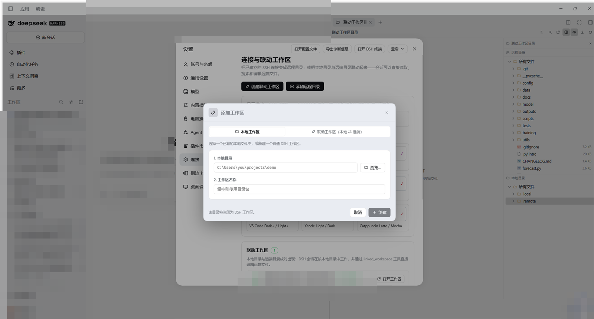
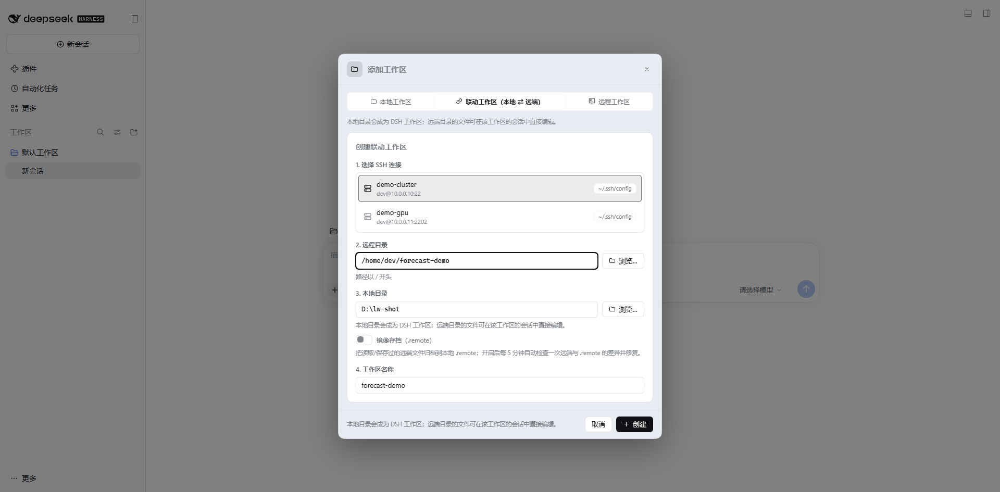
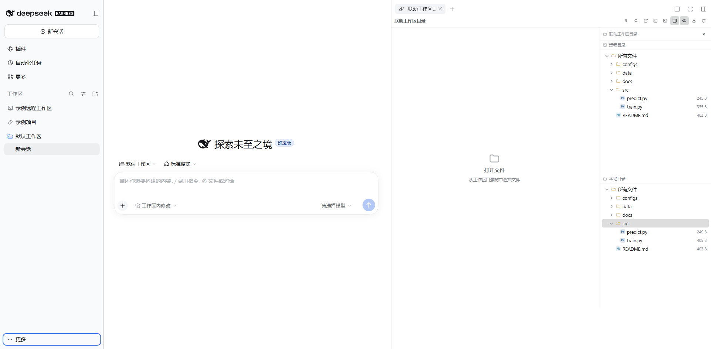
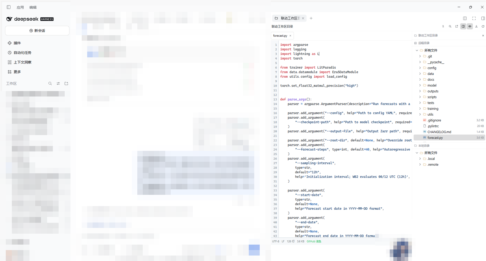

# dsh-linked-workspace

English · [简体中文](README.md)

Turn an existing SSH connection into a **linked workspace** or a **remote workspace** inside DeepSeek Harness: browse, edit and transfer remote files without syncing the code locally, and without installing any DSH component on the server.

- **Linked workspace**: pair a **local directory** with a **remote directory**. The local directory becomes a real DSH workspace; sessions run locally and read or edit remote files through the `linked_workspace` tool. The sidebar shows both trees and supports two-way transfer, comparison and drag-and-drop.
- **Remote workspace**: sessions run directly in the remote directory, so code, logs and `.dsh/` state all live on the server while only a placeholder directory stays local (it registers the DSH workspace). Local Skills and plugins still work; the model reads and writes remote files through the `linked_workspace` tool (or `fs.*` with `remoteId`).

> Targets DSH 0.2.1-rc.4. `dsh-better-sidebar` (v0.24+) is **optional**: with it you get the sidebar directory pages and the file editor; without it the plugin still loads and the settings page, the directory pickers and the `linked_workspace` tools keep working — only the sidebar pages are skipped.

## Two modes

| | Linked workspace | Remote workspace |
| --- | --- | --- |
| Purpose | Local ⇄ remote paired editing | Sessions that run entirely on the server |
| Local directory needed | Yes (registered as a DSH workspace) | No (only a placeholder directory) |
| Writable | Yes (editor, tools, transfer, delete…) | Yes (editor, tools; no local copy) |
| Sidebar entry | “Linked Workspace Directory” (two trees) | “Remote Workspace Directory” (remote tree only) |
| Model tools | `linked_workspace`, `linked_skills` | `linked_workspace` (remote scope), `linked_skills` |
| Typical use | Editing remote training code from a local setup | Training runs, long jobs, keeping everything off the laptop |

## Requirements

- **DSH**: 0.2.1-rc.4 or newer (`engines` allows `>=0.2.0-rc.2 <0.3.0-0`).
- **SSH**: the host must be configured in DSH's SSH Manager or `~/.ssh/config`; the first connection needs host-key confirmation in the “SSH Tunnel” tab.
- **dsh-better-sidebar** (optional): `>=0.24.0`. It renders the sidebar directory pages and the file editor; without it everything else (settings page, directory pickers, agent tools) still works.
- **Document editing** (optional): Python 3 with `python-docx`, `openpyxl`, `python-pptx` and `PyMuPDF`; set `DSH_OFFICE_PYTHON` to choose the interpreter. Markdown needs no Python.
- **Development**: Node.js ≥ 20.

## Quick start

1. **Install** the plugin (see [Install](#install)) and restart the DSH client.
2. **Add a workspace**: Settings → Linked workspaces → “Create linked workspace” or “Create remote workspace”, then pick an existing SSH host (add it in the DSH SSH Manager first if the list is empty).
3. **Pick directories**: a linked workspace needs a remote path plus a local folder (empty or new); a remote workspace needs only a remote path, and that directory must already exist — the plugin never creates it.
4. **Open the sidebar**: on the right sidebar start page choose “Linked Workspace Directory” or “Remote Workspace Directory”.
5. **Edit**: single-click a file to preview it, double-click to pin the tab; `Ctrl/Cmd + S` saves.

## Features

### Settings → Linked workspaces

- SSH hosts come from the `dsh-ssh-tunnel` SSH Manager (`~/.dsh/ssh-tunnel/hosts.json`) and `~/.ssh/config`; passwords and keys stay inside the Host process and are never returned to the page or the model.
- Remote workspace list: each card shows “remote · user@host + remote path” and the local placeholder directory, with **open workspace**, **open directory tree**, **test connection**, **rename** (renames the DSH workspace too) and **remove** (two-step confirmation; deletes the record, the placeholder directory and the DSH workspace, never remote files).
- Linked workspace list: local ⇄ remote paths, mirror toggle (**off by default**), background sync (archive into `.remote`, with file/byte progress and cancel), remove (optionally remove the DSH workspace and delete `.local`/`.remote`). With the mirror on, the first check runs immediately and then **every 5 minutes**: new or changed remote files are downloaded, mirror files that no longer exist remotely are deleted, unchanged files are skipped via `.local/mirror-manifest.json`, and `.git`/`node_modules`/cache directories are excluded. With the mirror off the two sides may diverge freely.
- A linked record without a DSH workspace shows “Register workspace” in its settings card, which registers it without recreating the record.
- **Editor theme**: display mode **System / Light / Dark** (default System, following the DSH theme); nine theme families (GitHub, Solarized, One, Dracula, Monokai, Nord, VS Code, Xcode, Catppuccin), each card previewing its light and dark variant.
- A single form serves “Create linked workspace” and “Create remote workspace”, reachable from both entry points.
- The file open mode (editor / system app / copy path) is switched from the sidebar toolbar and persisted.

### “Add workspace” on the left

The plugin takes over the DSH sidebar/hero directory-selection hole; the dialog offers three modes:

1. **Local workspace**: type or browse a local directory (drive letters C:/D:/E: on Windows), enter a name, create a normal DSH workspace.
2. **Linked workspace (local ⇄ remote)**: SSH host + remote directory + local directory + mirror toggle; the local directory becomes a DSH workspace.
3. **Remote workspace**: SSH host + remote directory + workspace name; the placeholder directory becomes a DSH workspace and sessions run on the server.

> Linked workspace rows no longer carry a `⇄` title prefix: a scoped stylesheet keyed on `data-row-key` swaps the host folder glyph for the workspace's own icon — two interlocking links for a linked workspace, a display with an outbound arrow for a remote workspace (normal local workspaces are untouched). When the SSH connection drops the row icon turns red, and the host's hover card gains a connection-state line (connected / not connected / connection lost), with the remote directory shown for a remote workspace and both the remote and local directories for a linked one. This is the only DOM-level adaptation of the host row; if DSH changes the row structure the selector stops matching and the original folder icon returns, with no other breakage.

### Sidebar: “Linked Workspace Directory”

- Fixed on the far right of the sidebar: **remote tree on top, local tree below**, both rooted at “All files”; the plugin's `.local`/`.remote` internal folders are hidden from the local tree.
- **Single-click opens, double-click pins**: single-click a folder to expand/collapse; single-click a file to open it in the content panel, replacing the current unpinned preview. Double-click a file to pin it so later single clicks do not replace it; double-clicking a folder only keeps it expanded.
- Toolbar (top right of the sidebar):
  - **Switch file tree**: all files / changed files / all changes. The change lists come from remote and local `git status` (branch, state, staged marker; deleted entries are greyed).
  - **Search in files**: after ≥2 characters, switch between “File name” and “Content”. Name mode uses `find` remotely and a local walk; content mode calls `fs.grep` (bounded local scan, `grep -rIl` remotely). Results are grouped into remote and local directories, with a truncation notice above 200 rows.
  - **Open options menu**: editor / system default app (downloads the remote file to a temp directory first) / copy path.
  - **Transfer button (two-way)**: with a remote file or folder selected it transfers to the local `.remote`; with a local file or folder selected it transfers to the matching relative remote path. Transfers run through a queue, one job at a time, with status and retry on failure.
  - **Open terminal**: the remote button sits at the top right of the remote tree and opens a system terminal via `ssh` in the current remote directory; linked workspaces also get a local button. The folder context menu adds “Open terminal here” for a subdirectory.
  - **Show/hide hidden files**: applies to both trees; hidden entries are shown by default when a directory opens (including `.local`/`.remote`).
  - **Refresh**: re-fetches the directory, git status and search; expanded directories refresh silently every 15 seconds and pause while the page is hidden.
- Coloured file-type icons (JS/TS/Python/JSON/Markdown/Shell/YAML/images/archives/config files…).
- **Tabs and editor**: up to 12 tabs, local and remote files share the same editor; line numbers, syntax highlighting (overlay), theme colours, `Ctrl/Cmd+S`, conflict prompt (reload / force save), read-only protection for binary and >2 MB files; the status bar shows encoding, line endings, line count and file size.
- **Find and replace**: `Ctrl/Cmd + F` opens an in-editor bar with a case-sensitive toggle, previous/next, a match counter, replace and replace all. Above 5000 matches the counter shows `5000+` while replace-all still edits the whole document; `Esc` closes it from the replace field too. The Markdown document panel has its own read-only find (`Ctrl+F`, counter, next/previous).
- **Image, CSV and HTML previews**: PNG/JPG/GIF/WebP/BMP/ICO/AVIF/SVG render in the content panel (up to 24 MB) with zoom buttons, `Ctrl/Cmd + wheel`, fit-to-window and 1:1; CSV/TSV open as a table with a Table/Source toggle (the source view stays editable), capped at 1000 rows × 80 columns. HTML/HTM render in a sandboxed iframe with scripts disabled; Markdown previews strip scripts, event attributes and dangerous links.
- **Shortcuts**: `Ctrl/Cmd+S` save, `Ctrl/Cmd+W` close tab (prompting when dirty), `Ctrl+Tab` / `Shift+Ctrl+Tab` cycle tabs, `Ctrl/Cmd+B` toggle the directory panel, `Ctrl/Cmd+Shift+F` file search.
- **Auto save**: Settings → Linked workspaces → “Editor behaviour”; saves about one second after typing stops. With it off, use `Ctrl/Cmd+S`; unsaved changes trigger a confirmation before the page unloads.

### Context menu (file/folder/root)

Transfer (download to `.remote`), download to the default folder, queue, open, edit with Notepad, copy, paste, copy path, **Move to…** (only within the same local or remote tree), rename, delete, change permissions, new (folder/file), properties. Folders also offer “Open terminal here”, and remote folders in a linked workspace offer “Compare with local…” when a local counterpart exists.

Selecting several rows (`Ctrl/Cmd`-click toggles, `Shift`-click selects a range) adds “Transfer selected (N)” and “Delete selected (N)” at the top of the menu; deletion asks for confirmation and aggregates per-item errors (e.g. a file deleted outside the app reports “path does not exist” while the rest are removed).

### Sidebar: “Remote Workspace Directory”

Appears automatically for sessions that belong to a remote workspace (and can be opened any time from the settings card):

- A **single remote tree** with no local pane; it is rooted at “All files” and the header shows `user@host · Remote`.
- Files open **read-only** in the built-in editor (encoding, line endings, line count and size are still shown) and are never written back locally.
- Context menu, search (name / content), hidden-file toggle and the 15-second refresh throttle match the remote tree of a linked workspace; transfer, two-way comparison and local-side actions are unavailable in this mode.
- Both directory tabs (linked and remote) register eagerly, so a remote tree can be opened from settings even while the current session belongs to a linked workspace.

### Transfer, comparison and conflicts

- **Drag and drop**: drag rows between the local and remote trees, or drop OS files onto either tree (the web client cannot read dropped file paths and says to use the desktop app). Hovering a collapsed folder for 700 ms while dragging expands it; dragging inside the same tree suggests “Move to…” instead.
- **Overwrite confirmation**: dropping onto a folder that already has the name no longer overwrites silently — a dialog offers cancel / keep both / overwrite. “Keep both” produces `name copy.txt` or `name (2).txt`. The API and tools accept `conflict=error|overwrite|unique`.
- **Local ⇄ remote comparison**: right-click a remote folder → “Compare with local…” groups entries into only-local / only-remote / changed (size differs, or mtime differs by more than 2 s); up to 4000 files and depth 12 per side, 200 rows per group, with a truncation notice. Clicking a row opens the file; each row can push to remote or pull to local; a missing local folder is called out explicitly.
- **Transfer queue**: one job at a time with queued/running/done/failed states; failed items can be retried.
- **Limits**: 8 MB per editor save; 150 files / 15 MB per “Transfer” or “Download to default folder”; 50 files / 64 MB each per drop-upload; mirror sync 500 files / 50 MB by default, skipping files over 20 MB.

### Model tools

| Tool | Purpose |
| --- | --- |
| `linked_workspace` | `list`, `info`, `list_dir`, `read`, `write`, `replace`, `stat`, `mkdir`, `rename`, `delete`, `sync`; paths are relative to the remote root, writes are atomic, `if_modified_since` provides optimistic concurrency. Works for both linked and remote workspaces (`sync` only applies to a linked workspace with the mirror on) |
| `linked_skills` | `list` / `read` local skills (`~/.dsh/skills`, `~/.agents/skills`, `<local>/.dsh/skills`, `<local>/.agents/skills`) |

The workspace resolves automatically when the session cwd falls inside a linked workspace or a remote workspace placeholder; use the `workspace` argument (id, local/placeholder path or name) across workspaces. The remote server only needs SSH — no plugin or Python installation.

### Running icon / local skills

- While a linked workspace has a running session, its link icon turns **blue** (refreshed about every 5 seconds).
- Linked sessions run in the **local directory**, so skills installed locally can be used directly; nothing has to be installed remotely, and the system prompt says so.

### Linked workspace layout

```
<local>/
  .local/            # created on demand (mirror manifest, etc.)
    mirror-manifest.json
  .remote/           # optional: mirrored remote files (written on read/save, full sync on demand)
```

## Screenshots

Settings → “Linked workspaces”: the upper half lists **linked workspaces** (local folder ⇄ remote folder), the lower half lists **remote workspaces** (the session runs inside the remote folder). Each card shows the connection state; linked workspaces also have the mirror switch and the sync button. The host name and the local placeholder path are blurred in this shot.



Click “Add workspace” next to the workspace title on the left: the dialog has three tabs (local workspace / linked workspace / remote workspace). Pick “Linked workspace (local ⇄ remote)”, choose an SSH connection, enter the remote folder, pick the local folder, then decide on mirroring and type a name; press “Create”.



The “Linked workspace directory” tab: the remote tree on top, the local tree below; files open from either side.



Clicking a file opens it in a new editor tab — remote files are read and written directly, with no sync step first.



## Install

Install the local folder into the current DSH profile:

```bash
dsh plugin --profile "$DSH_PROFILE" add "file:$PWD/dsh-linked-workspace"
```

You can also use `plugin_manager`'s `install_bundle` with the absolute path to this folder. Then **restart the DSH desktop app** (new Host plugins load at process start; session records are kept).

Two entry points afterwards:

1. Bottom-left account menu → Settings → “Linked workspaces”.
2. Or “Add workspace” next to the workspace title on the left, then the “Linked workspace (local ⇄ remote)” or “Remote workspace” tab.

The npm package is `dsh-linked-workspace`; released versions can also be installed from npm (plugin marketplaces read the npm latest version).

## Configuration

- **Settings → Linked workspaces**: editor theme and display mode, file open mode, auto save, mirror toggle, manual sync and removal options.
- **Data directory**: `$DSH_HOME/linked-workspace` (remote workspace records, linked records, settings); override with `DSH_LINKED_WORKSPACE_HOME`.
- **Python interpreter**: `DSH_OFFICE_PYTHON` for Office/PDF operations.
- **Terminal**: `DSH_LINKED_WORKSPACE_NO_TERMINAL=1` keeps “Open terminal” from launching a real window (used in tests).
- **SSH**: aliases from `~/.ssh/config` appear in the host list; host fingerprints are stored in the plugin data directory.

## Upgrading and versions

- Version history lives only in [CHANGELOG.md](CHANGELOG.md) (English) and [CHANGELOG.zh.md](CHANGELOG.zh.md) (简体中文).
- **Upgrading from 0.2.x**: the plugin was renamed to `dsh-linked-workspace` in 0.3.0. On first start it migrates `$DSH_HOME/remote-workspace` to `$DSH_HOME/linked-workspace` (remote directories, linked workspaces, theme settings and trusted host keys are preserved); uninstall `dsh-remote-workspace` afterwards.
- From 0.11.0 the tab id `dsh-remote-workspace` belongs to the new **Remote Workspace Directory** tab; only the old *file* tab alias (`dsh-remote-workspace:file`) is kept so previously opened file tabs are restored. Tree tabs opened before the upgrade close and are replaced by “Linked Workspace Directory”.
- If the UI does not change after an upgrade: the desktop app caches the client bundle — restart the client (or reload the page in the web UI).

## Security

- Credentials exist only inside the Host process; the API returns host names, addresses and workspace paths only.
- Host keys use trust-on-first-use: the SHA256 is recorded on first connect and any change is rejected.
- Remote workspaces and direct file APIs are confined to the configured remote root; linked-workspace tools are confined to the remote root, and local writes to the local root.
- Single-file saves are capped at 8 MB; mirror sync runs in the background (500 files / 50 MB by default, skipping oversized files), excludes `.git`/`node_modules`/caches, uses a 30 s per-file timeout and never blocks an HTTP request. “Transfer” and “Download to default folder” handle at most 150 files / 15 MB per run and report partial transfers.
- The page HTTP API accepts loopback same-origin requests only (remote deployments fall back to the DSH `connection` service's Host/Origin authentication).
- Previews do not execute scripts: HTML uses a `sandbox=""` iframe; Markdown/document previews strip scripts, inline styles, event attributes and `javascript:`/`vbscript:` links, keeping safe links and image `data:` URLs.

## FAQ

**No “Linked Workspace Directory” / “Remote Workspace Directory” entry in the sidebar?**
Check that `dsh-better-sidebar` (≥0.24) is installed and restart the client — those two pages are rendered by it. Once it is there, the “+” new-tab menu offers the entries that match the session's workspace kind: a linked workspace session lists “Linked Workspace Directory”, a remote workspace session lists “Remote Workspace Directory”, and a plain local workspace lists neither (both pages stay registered, so “Open directory tree” in Settings → Linked workspaces always works).

**Preview says “Python 3 and document libraries are required”?**
Install `python-docx`, `openpyxl`, `python-pptx` and `PyMuPDF`, or point `DSH_OFFICE_PYTHON` at an interpreter that has them. Markdown previews do not need Python.

**Search cannot find text inside files?**
The search bar matches file names by default — switch to “Content”. Content search is bounded to 1 MB per file, 2000 files, 8 MB and 5 s locally, with a truncation notice.

**Sync seems to do nothing?**
The mirror is off by default; enable it in Settings → Linked workspaces to archive into `.remote`. Runs over 500 files / 50 MB, or files over 20 MB, are skipped; progress is shown in the settings card.

**Drag and drop does nothing?**
Web browsers do not expose dropped file paths; the notice tells you to use the desktop app. Inside the same tree, use “Move to…” instead.

**Shortcut conflicts in the web UI?**
`Ctrl+W` and `Ctrl+Tab` are taken by the browser; use the DSH desktop app for those shortcuts.

**Changed the code but the UI is unchanged?**
Run `npm run build` to regenerate `lib/client.js`, then restart the DSH client; Host changes require a process restart.

## Architecture and development

```
Client (browser)                          Host (DSH process)
Settings → Linked workspaces / sidebar trees / directory dialogs → POST /dsh-linked-workspace/api
theme + highlight + file icons (src/parts/*)  workspace registry + linked registry + SSH pool
```

- `lib/index.js` — Host API, connection pool, linked workspaces, the `linked_workspace` tool, prompt section.
- `lib/ssh.js` — SSH/SFTP, remote command execution (`exec`), host discovery, TOFU fingerprints.
- `lib/git.js` — remote/local `git status` (porcelain parsing) and filename search.
- `lib/linked.js` — linked workspace persistence, `.local`/`.remote` layout, mirror read/write.
- `src/client.js` + `src/parts/*` → `scripts/build-client.mjs` → `lib/client.js` (single browser bundle).
- `docs/API.md` — API contract; `docs/VERIFY.md` — manual test checklist.

```bash
npm run build                       # regenerate lib/client.js
npm test                            # 63 unit tests + client bundle smoke check
node --check lib/index.js lib/ssh.js lib/linked.js src/client.js
node test/host-api.mjs              # full Host API against a real SSH host (28 steps)
node test/ssh-smoke.mjs             # real SSH transfer smoke test (optional)
```

On Windows, run `test/host-api.mjs` with DSH's bundled Electron Node (system Node 24.13 crashes when removing directories with CJK names).

## Publishing and marketplaces

- The npm package is `dsh-linked-workspace`; release a new version by bumping `package.json` and pushing a `v*` tag. `.github/workflows/release.yml` then runs `npm publish --access public` (requires the `NPM_TOKEN` repository secret).
- awesome-dsh-plugin (the DSH community marketplace) reads the npm latest version and repository metadata; upgrades are picked up automatically once listed. `market/awesome-dsh-plugin-entry.yml` is kept ready to submit.
- dsh-plugin.org (DSH Plugin Hub) periodically scans public repositories tagged `dsh-plugin` and reads the npm package; new versions appear without re-registering.
- Before publishing, run `npm run build && npm pack --dry-run` locally to inspect the package.

## License

MIT © 2026 Huangjh
