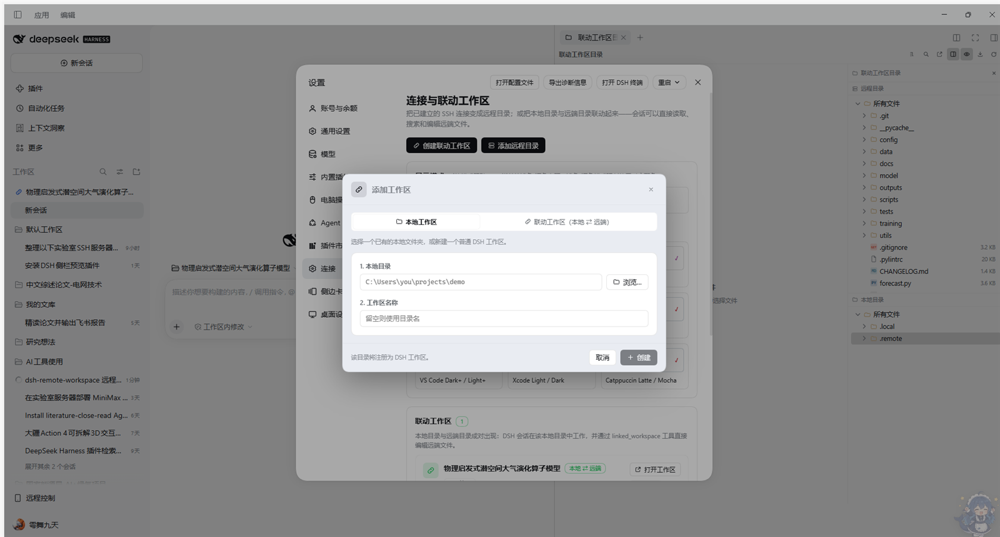
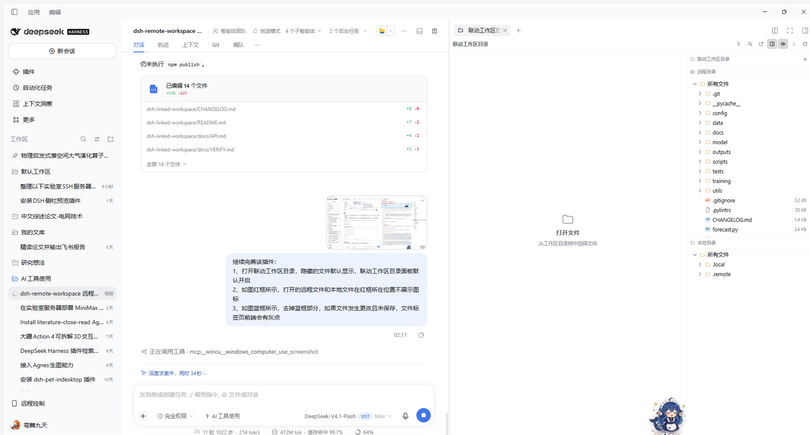
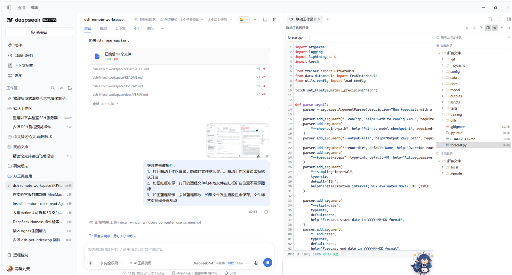

# dsh-linked-workspace

把已经建立好的 SSH 连接变成 DeepSeek Harness 里的**远程目录**或**联动工作区**：

- **远程目录**：设置 → 连接 → 添加远程目录，选主机和远端目录，右侧栏即可浏览、阅读和编辑远端文件，保存即写回服务器。
- **联动工作区**：左侧「添加工作区」（或设置 → 连接 → 添加联动工作区）把**本地目录**与**远端目录**配对。该本地目录会注册成真正的 DSH 工作区，里面的会话通过 `linked_workspace` 工具直接读取、编辑远端文件；远端服务器只需 SSH，不需要安装任何 DSH 插件。右侧栏的「联动工作区目录」同时展示远端树（上）与本地树（下）。

> 面向 DSH 0.2.1-rc.4；侧边栏页面依赖 `dsh-better-sidebar`（v0.24+）。没有它时插件仍会加载（设置页可用），但侧边栏入口不会出现。

## 功能

### 连接与设置（设置 → 连接）

- SSH 主机来自 `dsh-ssh-tunnel` 的 SSH Manager（`~/.dsh/ssh-tunnel/hosts.json`），也支持 `~/.ssh/config`；密码/私钥只在 Host 进程内使用，永不返回给页面或模型。
- 远程目录列表：添加（选主机 + 浏览远端目录）、测试、打开、移除。
- 联动工作区列表：本地 ⇄ 远端路径、镜像开关（**默认关闭**）、后台同步（归档到 `.remote`，显示文件数/体积进度，可取消）、移除（可选同时移除 DSH 工作区、删除 `.local`/`.remote`）。开启镜像后首次立即检查，之后**每 5 分钟**自动比较远端与 `.remote`：下载新增/变更文件、删除远端已不存在的镜像文件、跳过未变更文件（`.local/mirror-manifest.json`），并排除 `.git`/`node_modules`/缓存目录；关闭镜像时允许两侧存在版本和文件差异。
- **编辑器主题**：显示模式分 **系统 / 浅色 / 深色**（默认系统：跟随 DSH 当前主题）；指定主题为 **9 张卡片**（GitHub、Solarized、One、Dracula、Monokai、Nord、VS Code、Xcode、Catppuccin），每张卡同时包含浅色/深色版本，预览随模式卡选择实时切换。
- 添加远程目录 / 添加联动工作区共用同一个表单，可在两处入口使用。
- 文件打开方式（编辑器 / 系统默认应用 / 复制路径）由右侧栏工具栏的「打开选项菜单」切换并持久化。

### 左侧「添加工作区」

插件接管了 DSH 侧边栏/空白会话的目录选择 hole，弹窗提供两种模式：

1. **本地文件夹**：浏览本机目录（支持新建文件夹、Windows 系统选择器），选中即注册普通工作区。
2. **远程联动**：SSH 主机 + 远端目录 + 本地目录 + 镜像开关，创建后本地目录成为 DSH 工作区。

> 左侧工作区行不再带 `⇄` 标题前缀：插件用一份按 `data-row-key` 定位的样式表，把联动工作区行的宿主文件夹图标替换成**链环图标**（普通本地工作区不受影响）。这是对宿主行结构的唯一 DOM 级适配；如果 DSH 以后更改行结构，选择器会自然失配并回退到原来的文件夹图标，不破坏其他功能。

### 右侧栏入口

- **联动工作区目录**：只在联动工作区的会话中出现；点开后绑定该会话对应的联动工作区（不会打开另一个联动工作区），可编辑远程与本地文件。
- **远程目录**：只要设置 → 连接中至少添加了一个远程目录，任何工作区会话都能打开；只读浏览目录与文件，不允许编辑、传输、重命名或删除。
- 两种入口都由右侧栏开始页的 + 菜单进入；非联动会话不会出现联动工作区目录选项。

### 右侧栏「联动工作区目录」

- 面板固定在右侧栏最右边：**上方远程目录树，下方本地目录树**，两棵树根部都显示「所有文件」；本地树自动隐藏插件的 `.local`/`.remote` 内部目录。
- **单击选中，双击打开**：单击行只选中（高亮），双击文件夹展开/折叠，双击文件在**文件内容面板**的新标签中打开；目录面板固定在最右侧，始终可见。
- **面板布局**：目录树是右侧固定面板（带工具栏按钮开/关，不再是标签页）；会话面板与目录面板之间是文件内容面板，没有打开文件时显示「打开文件 / 从工作区目录树中选择文件」占位。
- 工具栏（右键栏右上角）：
  - **切换文件树**：所有文件 / 已更改的文件 / 所有更改。更改列表来自远端与本地的 `git status`（分支、状态、暂存标记；删除项置灰）。
  - **在文件中搜索**：搜索框输入 ≥2 个字符后，远端用 `find`、本地用目录遍历按文件名过滤，结果分「远程目录 / 本地目录」列出。
  - **打开选项菜单**：编辑器 / 系统默认应用（把远端文件下载到临时目录后交给本机应用打开）/ 复制路径。
  - **传输按钮**：先选中远端文件/文件夹，点该按钮即通过 SFTP 传输到 `.remote`（进入传输队列，一次一个任务并显示状态）。
  - **显示/隐藏隐藏文件**：同时约束远程目录和本地目录；打开目录时默认显示隐藏项（包括 `.local`/`.remote`），可用按钮隐藏。
  - **刷新**：重新拉取根目录、git 状态与搜索。
- 不同文件类型使用不同彩色图标（JS/TS/Python/JSON/Markdown/Shell/YAML/图片/压缩包/配置文件等）。
- 编辑器：行号、语法高亮（叠层渲染）、主题配色、`Ctrl/Cmd+S` 保存、冲突提示（重新加载/强制保存）、二进制与 >2 MB 文件只读保护、UTF-8/LF/CRLF/行数状态栏；内嵌内容面板不显示文件路径/保存工具条，未保存修改在文件标签前显示灰点。
- **多个文件同时打开**：每个文件占用一个独立的隐藏页面类型作为标签槽（最多 12 个），点文件即新增标签、重复点同一文件聚焦原标签；本地文件走 DSH 原生编辑器标签。

### 运行中图标 / 本地技能

- 联动工作区下若有正在运行的会话（本地会话 turn 进行中），左侧工作区的链环图标会变成**蓝色**；刷新间隔约 5 秒。
- 联动会话运行在**本地目录**，因此本机安装的技能（`~/.dsh/skills`、`~/.agents/skills`、`<local>/.dsh/skills`、`<local>/.agents/skills`）可直接使用，**不需要安装到远程目录**。模型可用 `linked_skills` 工具 `list`/`read`，提示词也会明确说明。

### 右键菜单（文件/文件夹/根节点）

传输（下载到 `.remote`）、下载到默认文件夹、队列、打开、用记事本编辑、复制、粘贴、复制路径、重命名、删除、更改权限、新建（文件夹/文件）、属性。远端操作走 SFTP；本地目录的同类操作走本机文件系统。传输队列一次执行一个任务并显示排队/传输中/完成/失败状态。

### 联动工作区结构

```
<local>/
  .local/
    linked.json      # 本地 ⇄ 远端绑定清单（主机、远端根、镜像开关；无凭据）
    session/         # 会话过程所需的中间文件目录
    README.md        # 插件说明
  .remote/           # 可选：远端文件镜像存档（读取/保存时自动归档，可手动全量同步）
```

会话中的模型工具 `linked_workspace` 支持：
`list`（列出联动工作区）、`info`、`list_dir`、`read`、`write`、`replace`、`stat`、`mkdir`、`rename`、`delete`、`sync`（启动后台镜像任务）。
`path` 相对远端根目录（或根内绝对路径）；写入原子化，可用 `if_modified_since` 做乐观并发控制；会话工作目录落在某个联动工作区时会自动解析，跨工作区可用 `workspace` 参数指定。

## 界面







## 安装

```bash
dsh plugin --profile "$DSH_PROFILE" add "file:$PWD/dsh-linked-workspace"
```

或在 DSH 里使用 `plugin_manager` 的 `install_bundle`，目标填本目录绝对路径。安装后**重启 DSH 桌面应用**（新 Host 插件在进程启动时加载；会话记录保留）。之后：

1. 左下角「账号菜单」→ 设置 →「连接」；
2. 或直接点左侧工作区的「添加工作区」，选「远程联动」。

## 从 0.2.x 升级

0.3.0 起插件改名为 `dsh-linked-workspace`。安装新包后，首次启动会把旧的 `$DSH_HOME/remote-workspace` 数据目录迁移到 `$DSH_HOME/linked-workspace`（远程目录、联动工作区、主题设置、已知主机指纹都会保留）；随后卸载旧包 `dsh-remote-workspace` 即可。

已打开的旧右侧栏「远程目录」标签页会在刷新后自动恢复（插件保留了两个隐藏的旧 tab 类型别名），标签标题也会自动改成「联动工作区目录」，新开的标签使用新的 `dsh-linked-workspace` 类型。

### 0.5.11 变化

远程目录的只读文件现在能看到代码内容；设置里「打开工作区」会跳转并关闭设置，远程目录「打开」会打开对应远程标签。

### 0.5.10 变化

本地工作区页签改为「输入框 + 浏览…」再展开目录选择；设置→连接移除「打开右侧栏」按钮。

### 0.5.9 变化

添加工作区弹窗的联动表单改用底部「取消 + 创建」；设置里的「创建联动工作区」表单标题/按钮同步，远程目录按钮改为「添加」。

### 0.5.8 变化

添加表单标题随类型显示「添加联动工作区」/「添加远程目录」；Ctrl+O/添加工作区的「本地工作区」页签提供本地目录 + 工作区名称两项并可创建普通本地工作区。

### 0.5.7 变化

点击“添加联动工作区”时表单锁定为联动模式，不再显示远程目录切换；点击“添加远程目录”时锁定为远程模式、不再显示联动切换和“工作区名称”字段。

### 0.5.6 变化

文案改为「直接浏览远端目录（只读）」；传输按钮支持远程→本地 `.remote` 与本地→远程双向；创建联动工作区不再强制生成 `.local`；本地路径选择器支持 C/D/E 等所有盘符；修复远程面包屑双斜杠。

### 0.5.5 变化

联动工作区目录只在联动会话出现并绑定当前工作区；远程目录成为独立的只读标签，任何会话只要配置了远程目录即可打开；空远程目录提示改为「还没有远程目录」。

### 0.5.4 变化

打开目录默认显示隐藏文件、目录面板默认开启；内嵌文件标签不再显示图标；去掉内容面板的路径/保存头部，未保存修改以灰点显示在标签前。

### 0.5.3 变化

主题改为 9 个主题家族（同名主题一张卡，浅/深版本随模式预览）；右侧栏改为「文件内容面板 + 最右侧目录面板」布局，目录面板有开关、不再占标签页；本地文件可在内容面板内直接编辑（`local.read`/`local.write`），本地标签不显示图标。

### 0.5.2 变化

本地树的隐藏文件开关同时控制 `.local`/`.remote`；目录行改为单击选中、双击展开/打开，文件以后台标签打开且面板保持目录；主题模式卡与主题卡增加浅色/深色预览和标注；设置页「添加联动工作区」移到「添加远程目录」前面。

### 0.5.1 变化

编辑器主题改为 系统/浅色/深色 三模式（默认系统）；联动工作区有运行中会话时链环图标变蓝；新增 `linked_skills` 本地技能桥与 `skills.list/read` API，联动会话直接使用本机技能，不需要装到远端。

### 0.5.0 变化

默认 GitHub 浅色主题；镜像同步默认关闭，开启后每 5 分钟自动检查远端与 `.remote` 差异；右侧栏新增传输按钮、显示/隐藏隐藏文件、右键菜单（传输/下载/记事本/复制粘贴/重命名/删除/权限/新建/属性）与传输队列；多个远端文件可同时以独立标签页打开。详见 [CHANGELOG.md](CHANGELOG.md)。

## 安全

- 凭据只存在于 Host 进程；API 只返回主机名、地址和工作区路径。
- 主机指纹 TOFU：首次连接记录 SHA256，变化即拒绝。
- 直接远程目录的读写限制在该目录内；联动工作区的工具限制在远端根目录内。
- 单文件保存上限 8 MB；镜像同步在后台执行，默认最多 500 文件 / 50 MB（跳过超大文件），默认排除 `.git`/`node_modules`/各类缓存目录，单文件读取 30 s 超时，不再阻塞 HTTP 请求。右键「传输」与「下载到默认文件夹」单次最多 150 文件 / 15 MB（超限会提示未全部传输）。
- 页面 HTTP API 只接受本机回环同源请求（远程部署时回落到 DSH `connection` 服务的 Host/Origin 鉴权）。

## 架构与开发

```
Client (浏览器)                          Host (DSH 进程)
设置→连接 / 右侧栏双树工作台 / 目录选择弹窗  →  POST /dsh-linked-workspace/api
主题 + 高亮 + 文件图标（src/parts/*）      工作区注册表 + 联动注册表 + SSH 连接池
```

- `lib/index.js` — Host API、连接池、联动工作区、`linked_workspace` 工具、提示词段。
- `lib/ssh.js` — SSH/SFTP、远端命令执行（`exec`）、主机发现、TOFU 指纹。
- `lib/git.js` — 远端/本地 git status（porcelain 解析）与文件名搜索。
- `lib/linked.js` — 联动工作区持久化、`.local`/`.remote` 布局、镜像读写。
- `src/client.js` + `src/parts/*` → `scripts/build-client.mjs` → `lib/client.js`（单文件浏览器 bundle）。
- `docs/API.md` — API 契约；`docs/VERIFY.md` — 手测清单。

```bash
node scripts/build-client.mjs       # 重新生成 lib/client.js
node --check lib/index.js lib/ssh.js lib/linked.js
node test/linked.test.mjs           # 联动文件系统单测（node --test）
node test/parts.test.mjs            # 主题/高亮/图标单测
node test/client-smoke.mjs          # 客户端 bundle 注册自检
node test/git.test.mjs              # 远端/本地 git 状态与搜索（含真实 SSH 只读检查）
node test/ssh-smoke.mjs             # 真实 SSH 传输自检
node test/host-api.mjs              # 真实 SSH 下的完整 Host API（21 步，含后台同步与右键操作）
```

## License

MIT © 2026 Huangjh
