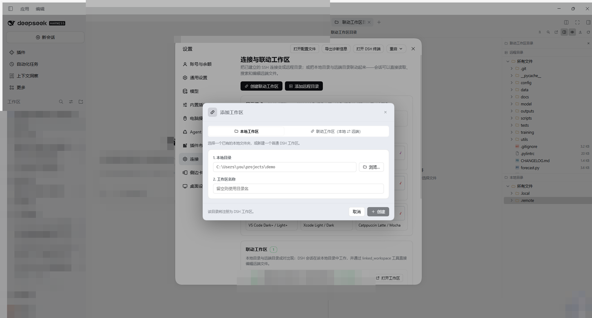
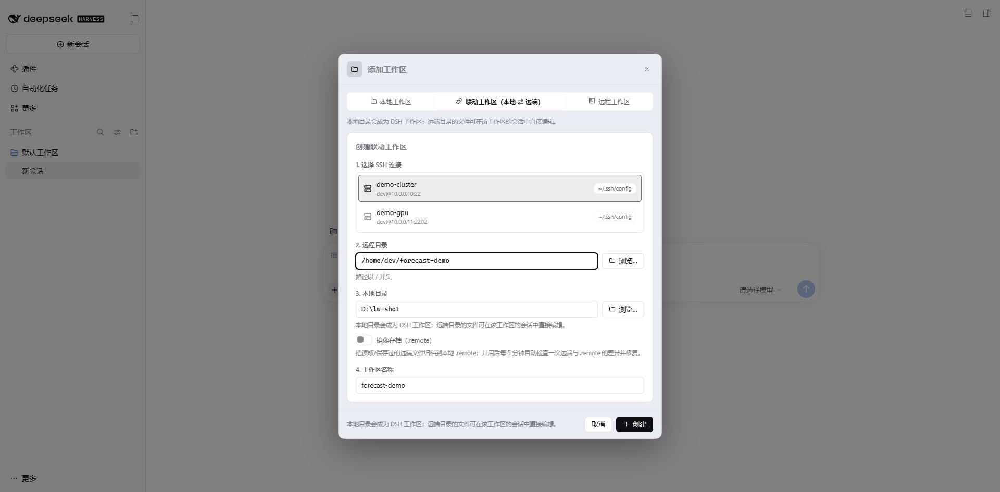
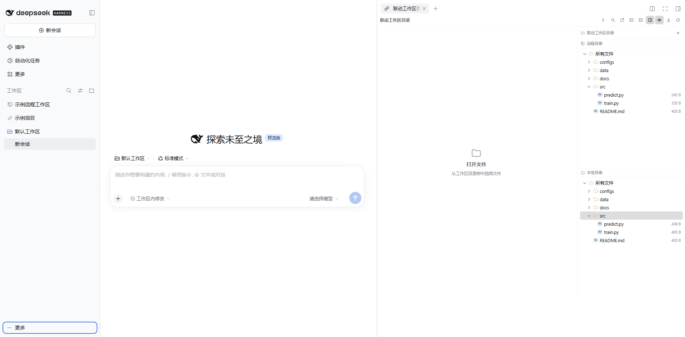
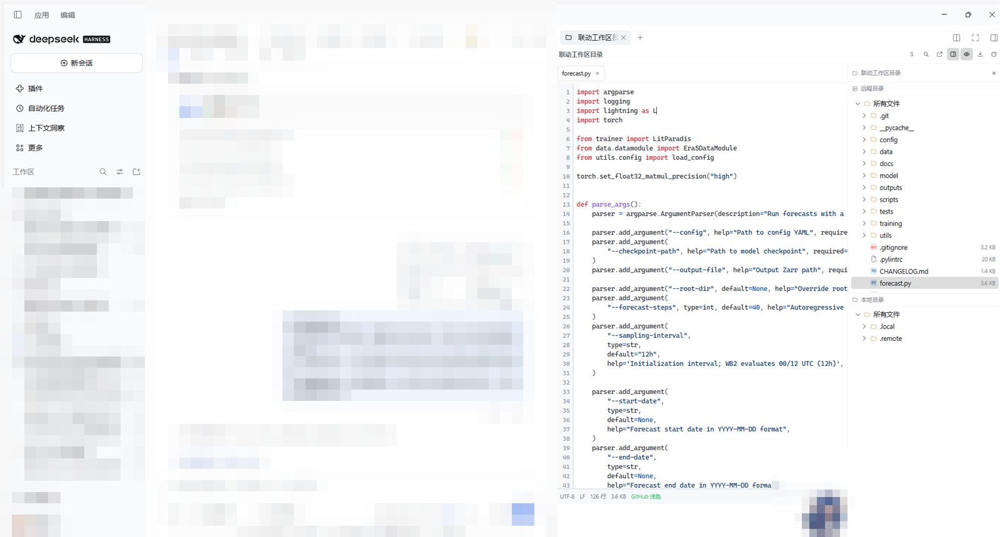

# dsh-linked-workspace

简体中文 · [English](README.en.md)

把已经建立好的 SSH 连接变成 DeepSeek Harness 里的**联动工作区**或**远程工作区**：不用把代码同步到本机，也不用在服务器上安装任何 DSH 组件，就能在 DSH 里浏览、编辑、传输远端文件，并让会话中的模型直接改远端代码。

- **联动工作区**：把**本地目录**与**远端目录**配对，本地目录注册成真正的 DSH 工作区。会话在本地目录运行，通过 `linked_workspace` 工具读写远端文件；右侧栏同时展示远端树与本地树，可以双向传输、对比、拖拽。
- **远程工作区**：会话直接运行在远端目录，所有代码、日志、`.dsh/` 状态都写入远端，本地只留一个占位目录用来把工作区注册进 DSH。支持本地 Skills 和插件，模型用 `linked_workspace` 工具（或带 `remoteId` 的 `fs.*` API）读写远端文件。

> 面向 DSH 0.2.1-rc.4。`dsh-better-sidebar`（v0.24+）是**可选**的：装上它才有右侧栏目录页与文件编辑页；没有它时插件照常加载，设置页、目录选择与 `linked_workspace` 等模型工具都能用，只是不注册侧边栏页面。

## 两种模式

| | 联动工作区 | 远程工作区 |
| --- | --- | --- |
| 用途 | 本地 ⇄ 远端配对编辑 | 会话直接在远端运行 |
| 需要本地目录 | 是（会注册成 DSH 工作区） | 否（使用占位目录） |
| 可写 | 是（编辑器、工具、传输、删除等） | 是（编辑器、工具） |
| 右侧栏入口 | 「联动工作区目录」（上下双树） | 「远程工作区目录」（只有远端树） |
| 模型工具 | `linked_workspace`、`linked_skills` | `linked_workspace`（远程 scope）、`linked_skills` |
| 典型场景 | 在本地 VSCode 与远端训练代码之间来回改 | 服务器上开发，本地只做可视化和监控 |

## 环境要求

- **DSH**：0.2.1-rc.4 或更高（`engines` 允许 `>=0.2.0-rc.2 <0.3.0-0`）。
- **SSH**：主机写在 `~/.ssh/config`，或加入 DSH 的 SSH Manager（`dsh-ssh-tunnel`，可选）。裸 `~/.ssh/config` 也够用：插件自带 SSH 客户端，首次连接**自动信任并记录**主机指纹到 `$DSH_HOME/linked-workspace/known_hosts.json`，指纹变化时拒绝连接并提示删除对应条目。**不安装 `dsh-ssh-tunnel` 也能用**：没有 `IdentityFile` 的主机可在这个插件的「添加工作区」弹窗里填一次密码，密码保存在本机（见「配置 → SSH 凭据」）。
- **dsh-better-sidebar**（可选）：`>=0.24.0`。装上才有右侧栏目录页与文件编辑页；缺少时其余功能（设置页、目录选择、模型工具）照常可用。
- **文档编辑**（可选）：Python 3 及 `python-docx`、`openpyxl`、`python-pptx`、`PyMuPDF`；可用 `DSH_OFFICE_PYTHON` 指定解释器。Markdown 不需要 Python。
- **开发**：Node.js ≥ 20。

## 快速开始

1. **安装插件**（见[安装](#安装)），重启 DSH 客户端；首次打开时插件会弹出一张欢迎卡片，点「知道了」即可（之后不再出现）。
2. **添加工作区**：设置 → 联动工作区 →「创建联动工作区」或「创建远程工作区」，选择已有 SSH 主机；列表里没有就把主机写进 `~/.ssh/config`（或在 DSH 的 SSH Manager 里添加），然后点「刷新」。
3. **选目录**：联动工作区需选远端路径和本地目录；远程工作区只需选远端路径（该目录必须已存在，插件不会自动创建）。
4. **打开右侧栏**：会话右侧栏开始页点「联动工作区目录」（联动）或「远程工作区目录」（远程）。
5. **开始编辑**：单击文件打开预览，双击固定标签；`Ctrl/Cmd + S` 保存。

## 功能

### 连接与设置（设置 → 联动工作区）

- SSH 主机来自 `dsh-ssh-tunnel` 的 SSH Manager（`~/.dsh/ssh-tunnel/hosts.json`，可选），也支持 `~/.ssh/config`；两者的密码/私钥只在 Host 进程内使用，永不返回给页面或模型。没有安装 SSH Manager 时，插件会自己在本机保存密码（见「配置 → SSH 凭据」）。
- **联动工作区**列表：本地 ⇄ 远端路径、镜像开关（**默认关闭**）、后台同步（归档到 `.remote`，显示文件数/体积进度，可取消）、移除（可选同时移除 DSH 工作区、删除 `.local`/`.remote`）。开启镜像后首次立即检查，之后**每 5 分钟**自动比较远端与 `.remote`：下载新增/变更文件、删除远端已不存在的镜像文件、跳过未变更文件（`.local/mirror-manifest.json`），并排除 `.git`/`node_modules`/缓存目录；关闭镜像时允许两侧存在版本和文件差异。
- **远程工作区**列表：每张卡片显示「远端 · 用户名@主机 + 远端路径」和「本地占位目录」，提供**打开工作区**（切到该 DSH 工作区）、**打开目录树**、**测试连接**、**重命名**（同步改名 DSH 工作区）、**移除远程工作区**（两步确认；同时删除占位目录和 DSH workspace 注册，不动远端文件）。
- 联动记录若没有对应的 DSH 工作区，设置卡会显示「注册为工作区」，点击即可补注册，无需删除重建。
- **编辑器主题**：显示模式分 **系统 / 浅色 / 深色**（默认系统：跟随 DSH 当前主题）；指定主题为 **12 张卡片**（GitHub、Solarized、One、Dracula、Monokai、Nord、VS Code、Xcode、Catppuccin、Tokyo Night、Gruvbox、Ayu），每张卡上下两条色带同时预览这一套的浅色与深色版本。
- **设置标签页**：除了桌面端「设置 → 联动工作区」，插件还在右侧栏注册了「联动工作区设置」标签（目录工具栏的齿轮按钮或「+」菜单打开），浏览器里也能改全部设置。
- 添加联动工作区 / 添加远程工作区共用同一个表单，可在两处入口使用。
- 文件打开方式（编辑器 / 系统默认应用 / 复制路径）由右侧栏工具栏的「打开选项菜单」切换并持久化。

### 左侧「添加工作区」

插件接管了 DSH 侧边栏/空白会话的目录选择 hole，弹窗提供三种模式：

1. **本地工作区**：填写或浏览本地目录（Windows 支持 C:/D:/E: 等盘符），填写工作区名称后创建普通 DSH 工作区。
2. **联动工作区（本地 ⇄ 远端）**：SSH 主机 + 远端目录 + 本地目录 + 镜像开关，创建后本地目录成为 DSH 工作区。
3. **远程工作区**：SSH 主机 + 远端目录 + 工作区名称，创建后占位目录成为 DSH 工作区，会话直接跑在远端。

> 左侧工作区行不再带 `⇄` 标题前缀：插件用一份按 `data-row-key` 定位的样式表，把宿主文件夹图标换成工作区自己的图标——联动工作区是**双链环**，远程工作区是**显示器 + 出链箭头**，普通本地工作区不受影响。SSH 连接断开时该行的图标会变红；把鼠标停在行上，宿主那张悬停信息卡里名字下面会多出一行「SSH 主机 · 连接状态」（形如 `RTX-PRO-6000-1 · 已连接`，掉线后变红并显示「连接已断开」）；远程工作区显示远端目录、联动工作区同时显示远端与本地目录。这是对宿主行结构的唯一 DOM 级适配；如果 DSH 以后更改行结构，选择器会自然失配并回退到原来的文件夹图标，不破坏其他功能。
>
> 这一行状态是**跟着实际连通性走的**：页面每 6 秒向宿主取一次各主机的连接状态（只读内存、不发起新连接），只有状态真的变了才重绘那一行，卡片开着时也会即时更新——主机掉线几秒内变「连接已断开」，恢复后自动回到「已连接」，不用刷新页面。一次失败只代表当时：没人再验证的旧错误 60 秒后降级为「未连接」；「测试连接」发现远端目录不存在也不会被当成断连，不会把同一台主机上的其它工作区一起标红。
>
> 所以刚重启 DSH 时，还没打开过的工作区显示「未连接」是正常的——那是「这个进程还没连过」而不是「连不上」。想立刻确认，点设置页卡片上的**重新连接**：它会丢掉旧连接、当场拨一次号，成功就变「已连接」并显示耗时，失败则把主机的原话显示出来。

### 聊天产物一键定位

对话里的文件 chip、工具行的文件名、产物卡片都支持右键：

- **在远程目录中打开** / **在本地目录中打开** —— 打开右侧面板并把那个文件直接定位、打开成标签页。
- **复制远程路径** —— 复制远端绝对路径，方便贴给模型或终端。

「设置 → 联动工作区 → 产物默认打开位置」可以选默认走远端还是本地；远程工作区的会话没有本地副本，所以永远只开远端那一份。

### 右侧栏「联动工作区目录」

目录栏标题右侧显示该工作区所在远端卷的可用空间，悬停可看到总量与已用百分比。

- 面板固定在右侧栏最右边：**上方远端树，下方本地树**，两棵树根部都显示「所有文件」；本地树自动隐藏插件的 `.local`/`.remote` 内部目录。
- **单击打开，双击固定**：单击文件夹立即展开/折叠；单击文件直接在文件内容面板打开，再次单击其他文件会替换当前未固定的预览标签。双击文件可固定该标签，之后单击其他文件不会覆盖它；双击文件夹只保持展开。
- 工具栏（右侧栏右上角）：
  - **切换文件树**：所有文件 / 已更改的文件 / 所有更改。更改列表来自远端与本地的 `git status`（分支、状态、暂存标记；删除项置灰）。
  - **在文件中搜索**：输入 ≥2 个字符后搜索，可在「文件名 / 内容」之间切换。文件名模式远端用 `find`、本地遍历目录；内容模式调用 `fs.grep`，本地与远端共用一套限额（单文件 1 MB、2000 文件、8 MB、5 秒）并默认跳过 `node_modules`、`.git`、`site-packages`、`dist`、`build`、`target`、`.venv`、`.conda` 等目录。结果分「远端 / 本地」列出，**每条显示 `路径 :行号` 和命中的片段**，点击直接打开并把光标定位到该行；被截断时提示会说明原因（文件数 / 体积 / 时间 / 结果上限），超过 200 条也会提示。搜索栏还有三枚开关：`Aa` 区分大小写、`.*` 按正则匹配、文件夹 chip 把范围限定在当前选中的目录。
  - **键盘**：目录树与结果列表支持 `↑`/`↓`/`Home`/`End`，`→` 展开、`←` 收起（文件上按 `←` 回到父目录），`Enter` 打开；搜索框里按 `↓` 直接进入结果列表。文件行悬停时提示里会显示「修改于 …」和大小（按需查询，缓存 5 秒）。
  - **打开选项菜单**：编辑器 / 系统默认应用（把远端文件下载到临时目录后交给本机应用打开）/ 复制路径。
  - **传输按钮（双向）**：选中远端文件/文件夹时传输到本地 `.remote`；选中本地文件/文件夹时传输到远端对应相对路径（进入传输队列，一次一个任务并显示状态，失败可重试）。
  - **打开终端**：远程按钮位于远端树右上角，打开本机终端并用系统 `ssh` 直接进入当前远端目录；联动工作区还会显示本地按钮，直接打开本地目录。右键目录还可用「在此打开终端」在该子目录启动。
  - **显示/隐藏隐藏文件**：同时约束远端树和本地树；打开目录时默认显示隐藏项（包括 `.local`/`.remote`），可用按钮隐藏。
  - **刷新**：重新拉取目录、git 状态与搜索；展开的目录每 15 秒静默刷新一次，页面隐藏时暂停。
- 不同文件类型使用不同彩色图标（JS/TS/Python/JSON/Markdown/Shell/YAML/图片/压缩包/配置文件等）。
- **标签会记住**：打开的文件按面板（会话 + 模式 + 固定的工作区）记在浏览器本地，刷新页面或重启 DSH/Host 后重新打开目录标签，之前开着的文件会原样回来（未保存的编辑与光标位置不会恢复）。
- **标签与编辑器**：最多同时打开 12 个标签，本地与远端文件共用内部编辑器；行号、语法高亮（叠层渲染）、主题配色、`Ctrl/Cmd+S` 保存、冲突提示（重新加载/强制保存）、二进制与 >2 MB 文件只读保护；状态栏显示编码、换行符、行数与文件大小。
- **查找/替换**：编辑器内 `Ctrl/Cmd + F` 打开查找条，支持区分大小写、上一个/下一个、命中计数、替换与全部替换；命中超过 5000 处时计数显示 `5000+`，全部替换仍作用于全文。替换框内按 `Esc` 也能关闭查找条。Markdown 文档面板另有只读查找（同样 `Ctrl+F`，支持计数与上下跳转）。
- **图片、CSV 与网页预览**：PNG/JPG/GIF/WebP/BMP/ICO/AVIF/SVG 直接在内容面板按图片显示（最大 24 MB），支持按钮缩放、`Ctrl/Cmd + 滚轮` 缩放、适应窗口和 1:1 原始大小；CSV/TSV 默认按表格显示，可在「表格 / 源码」间切换，源码视图仍可编辑保存，超过 1000 行或 80 列时只展示截断后的表格。HTML/HTM 以沙箱 iframe 渲染（脚本在独立源里运行，图表能画出来，但拿不到 DSH 界面与存储；上限 8 MB，超过时提示改下载后用浏览器打开），Markdown 预览会移除脚本、事件属性与危险链接。
- **快捷键**：`Ctrl/Cmd+S` 保存当前文件；`Ctrl/Cmd+W` 关闭当前标签（未保存时提示保存/放弃/取消）；`Ctrl+Tab` / `Shift+Ctrl+Tab` 切换标签；`Ctrl/Cmd+B` 显示/隐藏目录面板；`Ctrl/Cmd+Shift+F` 打开文件搜索。
- **自动保存**：设置 → 联动工作区 →「编辑器行为」中开启；停止输入约 1 秒后自动保存。关闭时使用 `Ctrl+S` 手动保存；有未保存文件时刷新/关闭页面会弹确认。

### 右键菜单（文件/文件夹/根节点）

传输（下载到 `.remote`）、下载到默认文件夹、队列、打开、用记事本打开副本（不回写）、复制、粘贴、**复制绝对地址**、**复制相对地址**、**移动到…**（只允许移动到同一棵本地树或同一棵远程树内的目录）、重命名、删除、更改权限、新建（文件夹/文件）、属性；远端目录行另有「复制 ssh 命令」，联动工作区本地树的行另有「推送到远端」，目录还提供「在此打开终端」，联动工作区的远端目录在本地存在对应路径时提供「与本地对比…」。

**复制绝对地址**给完整路径，**复制相对地址**给相对工作区根目录的路径（左树相对本地根、右树相对远端根）——粘到终端或编辑器里都是能直接用的地址。

选中多个文件（`Ctrl/Cmd` 点击切换、`Shift` 点击按区间选择）后，菜单顶部出现「传输所选的 N 项」「删除所选的 N 项」；删除会先弹确认，逐项失败会聚合提示（例如外部已删掉的文件报「路径不存在」，其余照常删除）。

### 右侧栏「远程工作区目录」

会话属于某个远程工作区时自动出现（设置页的「打开目录树」也能随时打开）：

- 只有**一棵远端树**，不显示本地分栏；根节点同样是「所有文件」，标题栏显示 `用户名@主机 · 远程`。
- 文件可在内部编辑器里**直接编辑并保存回远端**（`Ctrl/Cmd+S`、自动保存、保存冲突提示、查找替换、按命中行跳转都与联动工作区一致）；只读保护仍按文件本身生效：二进制文件、超过 2 MB 或读取被截断时显示「只读」且不可输入。
- Markdown、Word、Excel、PowerPoint、PDF 等文档走各自的文档面板打开，编辑后同样保存回远端。
- 右键菜单、搜索（文件名 / 内容，含大小写、正则、限定当前目录）、隐藏文件开关、刷新节流（15 秒）与联动工作区的远端树完全一致：打开、用记事本打开副本、复制 / 粘贴、复制绝对地址、复制相对地址、复制 ssh 命令、移动到…、重命名、删除、更改权限、在此打开终端、新建文件 / 文件夹、属性、下载，以及批量的「删除所选」「移动所选」「批量重命名所选」。
- 只有依赖本地目录的四项仍然只对联动工作区开放：**传输到本地镜像、传输队列、与本地目录对比、本地终端 / 本地分栏**（远程工作区里传输按钮为禁用态，悬停提示「传输只在联动工作区可用（远端 → 本地）」）。
- 两个目录标签（联动 / 远程）都常驻注册，因此当前会话属于联动工作区时也能从设置页打开远程工作区目录树。

### 传输、对比与冲突处理

- **拖拽**：在本地树与远端树之间拖动文件即可互传；同一棵树内拖动（远端内或本地内）则是**移动**，选中多项后拖动会一起移动/传输。也可以把系统文件拖进任一树（Web 端浏览器无法读取拖入文件路径时会提示改用桌面端）。拖动时悬停在折叠目录上 700 ms 会自动展开；多选后用右键「移动所选的 N 项…」也能批量移动。
- **覆盖确认**：目标目录已有同名文件时，不再静默覆盖，而是弹出「取消 / 保留两者 / 覆盖」；保留两者会自动生成 `name copy.txt` 或 `name (2).txt`。工具与 API 也可用 `conflict=error|overwrite|unique` 指定策略。
- **本地 ⇄ 远端对比**：右键远端目录 →「与本地对比…」，按「仅本地存在 / 仅远端存在 / 大小或时间不同」分组列出；单侧最多扫描 4000 个文件、深度 12、每组展示 200 行，超限会提示。点行直接打开文件；每行可「推送到远端」或「拉取到本地」；本地缺少对应目录时会明确说明。
- **传输队列**：一次执行一个任务，显示排队/传输中/完成/失败，运行中会持续显示「已传 N 个 · X MB」；可以点「取消」中途停止（已经传完的文件保留）。失败项可重试。
- **上限**：编辑器保存单文件 8 MB；右键「传输」与「下载到默认文件夹」单次最多 150 文件 / 15 MB；拖拽导入/上传单次最多 50 个文件、单个 64 MB；镜像同步默认最多 500 文件 / 50 MB，单文件 20 MB 以上跳过。

### 模型工具

| 工具 | 用途 |
| --- | --- |
| `linked_workspace` | `list`、`info`、`list_dir`、`read`、`write`、`replace`、`stat`、`mkdir`、`rename`、`delete`、`sync`、`exec`；路径相对远端根目录，写入原子化，`if_modified_since` 做乐观并发控制。联动工作区与远程工作区都适用（远程工作区没有本地副本，`sync` 只用于开启镜像的联动工作区） |
| `linked_skills` | `list`、`read` 本地技能（`~/.dsh/skills`、`~/.agents/skills`、`<local>/.dsh/skills`、`<local>/.agents/skills`） |

会话工作目录落在某个联动工作区或远程工作区的占位目录时会自动解析；跨工作区可用 `workspace` 参数指定（支持 id、本地/占位路径或名称）。远端服务器只需要 SSH，不需要安装插件或 Python。

### 读文档、开隧道、访问工作区外（0.23.0）

- 模型可以直接读 **PDF / Word / Excel / PowerPoint 的文字**（`read_doc`），不用再自己装解析库。
- 远端跑着 TensorBoard、Jupyter 时，可以在 设置 → 联动工作区 → **端口转发** 里把它映射到本机 `127.0.0.1` 的端口，点 URL 就能在浏览器打开。隧道是**常驻的**：定义写进 `forwards.json`，刷新页面、重启应用或重启 Host 都会自动重新监听（原来的本机端口被占用时会换一个并记下来），只有点「停止」才会移除。
- 需要碰工作区之外的共享盘时，先在 设置 → 联动工作区 → **额外根目录** 里加前缀，模型才能用 `read_outside` / `write_outside` / `list_outside` 访问，而且每次访问都会记进 `outside-audit.jsonl`。
- 镜像同步进行中可以用 `sync_status` 看进度与计数。

### 远端命令执行（0.17.0，默认关闭）

`exec` 让模型在远端跑**一条非交互命令**（编译、跑测试、看日志），不用再自己拼 `ssh`。它默认是关的，要同时满足三件事才会执行：

1. 设置 → 联动工作区 → 「远端命令执行」里的总开关 `execEnabled`；
2. 该主机在**主机白名单** `execHostIds` 里；
3. 若填了**工作区白名单** `execWorkspaceIds`，当前工作区必须在其中（留空表示不限制）。

每次尝试——包括被拒绝的——都会写一行到 `$DSH_HOME/linked-workspace/exec-audit.jsonl`（含命令、退出码、耗时、输出的前 4 KB、拒绝原因），超过 5 MB 自动轮转为 `.1`；设置页有「打开审计日志」按钮。输出按 `execMaxOutputChars`（默认 200000 字符/流）截断，超时由 `execTimeoutMs`（默认 60 秒，单次最多 600 秒）控制，`cwd` 不能跑出工作区根目录。


### @ 引用与更细的搜索（0.18.0）

- `references` 动作（对应 `fs.references`）按**路径名**做大小写不敏感匹配，最佳匹配排在最前（完全同名 → 前缀 → 包含），目录带 `dir` 标记；模型可以用它把你口头提到的文件名解析成远端真实路径。
- 输入框里的 **`@`** 仍然是 DSH 原有的菜单（本地文件、文件夹、对话）；插件往这个菜单里又加了一组自己的候选：
  - 只要会话属于联动/远程工作区，单打一个 **`@`** 就会在 DSH 原生的本地候选之上，多出一组「**远程文件与文件夹**」（排在最前）——列出当前工作区远端树的文件与文件夹；选中后插入一个真正的引用 chip，模型收到的是该远端路径；
  - 行样式与 DSH 自带的「文件与文件夹」一致：**只有图标和名字**（不再跟一条释义），目录行右侧带「**进入目录 · Tab**」提示。按 `Tab` 或直接点该目录 → 菜单不关闭、光标处的 token 变成 `@目录/`，并列出这个目录里的内容，可以一层层往下走；
  - 也可以纯键盘打字：`@co` 按名字过滤，`@code/` 直接进到远端 `code/` 这一层。候选**每次只列一个目录**（走 `fs.list`），远端有几千个文件也是几百毫秒出结果，不会卡住菜单；
  - 只列当前目录、最多 30 条、跳过隐藏文件；想整体浏览仍用右侧栏的目录树。
- 右键仍然是取地址：**复制相对地址** / **复制绝对地址** 给出的是路径本身，不带 `@` 前缀。
- 内容搜索多了两枚开关：「包含通常忽略的目录」（`node_modules`/`.venv`/`dist` 也会搜，`.git` 始终排除）、「只列文件名」；搜索中可以点「停止」中途取消，结果上方会显示「扫描 N 个文件 · X」。
- 分组顺序：插件注册触发器时用 `order: -1`（DSH 按 `order` 升序排，它自己的 source 用默认 0），所以「远程文件与文件夹」总排在最前，其次是 DSH 原生的「文件与文件夹」「对话」。DSH 那组的标题归外壳的 `reference` 文案命名空间所有，插件无法改名。

### 运行中图标 / 本地技能

- 联动工作区下若有正在运行的会话（本地会话 turn 进行中），左侧工作区的链环图标会变成**蓝色**；刷新间隔约 5 秒。
- 联动会话运行在**本地目录**，因此本机安装的技能可直接使用，**不需要安装到远端**；提示词会明确说明这一点。

### 联动工作区结构

```
<local>/
  .local/            # 按需创建（镜像清单等）
    mirror-manifest.json
  .remote/           # 可选：远端文件镜像存档（读取/保存时自动归档，可手动全量同步）
```

### 把本地改动推回远端（0.19.0）

目录栏的同步按钮会比较本地与远端：新增、修改、冲突、远端已删四类都会列出来。点「推送（跳过冲突）」只写回本地改过、远端没动过的文件；两边都改过的会留在「冲突」里，只有明确选「推送并覆盖冲突」才会用本地版本覆盖。

想让它自动发生，可以在设置 →「联动工作区」→「自动推回远端」里开启：开关会先弹一段说明要你确认，开启后本地保存约 1.5 秒就会写回远端，而且始终跳过冲突。

## 界面

设置 →「联动工作区」：上半部分是**联动工作区**（本地目录 ⇄ 远端目录），下半部分是**远程工作区**（会话直接运行在远端目录）。卡片里能看到连接状态，联动工作区还有镜像开关和同步按钮。图中的主机名与本地占位目录做了模糊处理。



点左侧工作区标题旁的「添加工作区」，弹窗里有三个页签（本地工作区 / 联动工作区 / 远程工作区）。选「联动工作区（本地 ⇄ 远端）」后依次选 SSH 连接、填远端目录、选本地目录，再决定是否开镜像、填写工作区名称，底部「创建」即可。



「联动工作区目录」标签页：上面是远端目录，下面是本地目录，两边都能点开文件。



点击文件在新标签页打开编辑器，远端文件直接读写，不需要先同步到本地。



## 安装

从本地目录安装到当前 DSH profile：

```bash
dsh plugin --profile "$DSH_PROFILE" add "file:$PWD/dsh-linked-workspace"
```

也可以在 DSH 里用 `plugin_manager` 的 `install_bundle`，目标填本目录的绝对路径。安装后**重启 DSH 桌面应用**（新 Host 插件在进程启动时加载；会话记录保留）。

之后从两处进入：

1. 左下角「账号菜单」→ 设置 →「联动工作区」；
2. 或点左侧工作区标题旁的「添加工作区」，切到「联动工作区（本地 ⇄ 远端）」或「远程工作区」页签。

npm 包名为 `dsh-linked-workspace`，也可以从 npm 安装已发布版本（DSH 插件市场按 npm latest 版本展示）。

## 配置

- **设置 → 联动工作区**：编辑器主题与显示模式、文件打开方式、自动保存、镜像开关、手动同步与移除选项；下方依次是远端命令执行（开关 + 主机白名单 + 按工作区第二层，默认折叠）、SSH 信任与编码（含默认折叠的已知主机密钥清单）、额外根目录、端口转发。
- **数据目录**：`$DSH_HOME/linked-workspace`（远程工作区、联动记录、设置）；可用 `DSH_LINKED_WORKSPACE_HOME` 覆盖。
- **Python 解释器**：`DSH_OFFICE_PYTHON` 指定用于 Office/PDF 的 Python。
- **终端**：`DSH_LINKED_WORKSPACE_NO_TERMINAL=1` 关闭「打开终端」的实际启动（测试环境用）。
- **SSH 配置**：`~/.ssh/config` 中的别名会出现在主机列表；主机指纹保存在插件数据目录。
- **SSH 凭据**：主机列表的凭据来源有三处——`~/.ssh/config` 的 `IdentityFile`（含 SSH agent）、`dsh-ssh-tunnel` 的 SSH Manager（若已安装），以及插件自己的 `$DSH_HOME/linked-workspace/ssh-credentials.json`。没有私钥的主机在「添加工作区」弹窗里显示「需要密码」，选它、填一次密码再点「创建」即可：密码只写在本机这个文件里（权限 `0600`），只由 Host 进程读取，不会返回给页面或模型；之后再建工作区留空即沿用已存密码。填完可点「**验证密码**」先探一条连接，成功显示「密码可用」，失败直接给出服务器原话（例如 `All configured authentication methods failed.`）。用 `hosts.credentials` 的 `clear: true` 可以删除。
- **升级后某个新功能报 `unknown method`**：说明 Host 进程还在跑旧代码（页面会热更新、Host 不会）。完全退出 DSH 再启动即可。

## 升级与版本

- 版本变更与升级说明只维护在 [CHANGELOG.zh.md](CHANGELOG.zh.md)（中文）与 [CHANGELOG.md](CHANGELOG.md)（English）。
- **从 0.2.x 升级**：0.3.0 起插件改名为 `dsh-linked-workspace`。安装新包后，首次启动会把旧的 `$DSH_HOME/remote-workspace` 数据目录迁移到 `$DSH_HOME/linked-workspace`（远程工作区、联动工作区、主题设置、已知主机指纹都会保留）；随后卸载旧包 `dsh-remote-workspace` 即可。
- 0.11.0 起 tab id `dsh-remote-workspace` 归新的「远程工作区目录」标签使用；只保留了旧**文件标签**别名 `dsh-remote-workspace:file`，用来恢复升级前打开的文件标签。升级前后仍打开的旧目录树标签会关闭，改用「联动工作区目录」。
- 升级后如果界面没有变化：DSH 桌面端会缓存客户端 bundle，重启客户端（Web 端刷新页面）后再看。

## 安全

- 凭据只存在于 Host 进程；API 只返回主机名、地址和工作区路径。
- 主机指纹 TOFU：首次连接记录 SHA256，变化即拒绝。
- 直接远程工作区的读写限制在该目录内；联动工作区的工具限制在远端根目录内，本地写入限制在本地根目录内。
- 单文件保存上限 8 MB；镜像同步在后台执行，默认最多 500 文件 / 50 MB（跳过超大文件），默认排除 `.git`/`node_modules`/各类缓存目录，单文件读取 30 s 超时，不再阻塞 HTTP 请求。右键「传输」与「下载到默认文件夹」单次最多 150 文件 / 15 MB（超限会提示未全部传输）。
- 页面 HTTP API 只接受本机回环同源请求（远程部署时回落到 DSH `connection` 服务的 Host/Origin 鉴权）。
- HTML 预览跑在 `sandbox="allow-scripts"` 的 iframe 里：脚本能执行（plotly 这类图表才有内容），但处于独立的不透明源，访问不到 DSH 界面、宿主存储与标签页；Markdown/文档预览仍会移除脚本、内联样式、事件属性与 `javascript:`/`vbscript:` 等危险链接，只保留安全链接与图片 `data:` URL。
- 远端命令执行默认关闭，开启后仍受主机白名单（以及可选的工作区白名单）限制；每次执行（含被拒绝的尝试）都写审计日志，输出有长度上限、命令有超时，`cwd` 不能跑出工作区根目录。

## 常见问题

**右侧栏没有「联动工作区目录」/「远程工作区目录」入口？**
先确认已安装 `dsh-better-sidebar`（≥0.24）并重启客户端——这两个页面由它渲染，装了没有就只剩设置页。装好之后，「+」新标签页菜单按当前会话所属的工作区类型列出入口：联动工作区会话只列「联动工作区目录」，远程工作区会话只列「远程工作区目录」，普通本地工作区两条都不列（页面仍然常驻注册，设置 → 联动工作区里的「打开目录树」随时能直接打开）。

**预览报「需要 Python 3 与文档库」？**
安装 `python-docx`、`openpyxl`、`python-pptx`、`PyMuPDF`，或用 `DSH_OFFICE_PYTHON` 指向带这些库的解释器。Markdown 预览不需要 Python。

**搜索找不到正文里的内容？**
搜索条默认按文件名匹配，切到「内容」模式再搜；内容搜索对本地单文件限 1 MB、最多 2000 个文件、8 MB、5 秒，超限会提示原因。远程搜索有同样的限额，并默认跳过 `node_modules`、`.conda`、`site-packages` 等目录——确实要搜这些目录时，请把范围限定到更具体的文件夹，或改用「文件名」模式。

**同步没有变化？**
镜像默认关闭；在设置 → 联动工作区里开启后才会归档到 `.remote`。超过 500 文件 / 50 MB 或单文件 20 MB 的部分会跳过，可在面板里查看同步进度。

**拖拽没反应？**
Web 端浏览器不暴露拖入文件的真实路径，会提示改用桌面端；同一棵树内拖动请用右键「移动到…」。

**Web 端快捷键冲突？**
`Ctrl+W`、`Ctrl+Tab` 会被浏览器占用，请在 DSH 桌面端使用这些快捷键。

**改了代码但界面没变？**
先 `npm run build` 重新生成 `lib/client.js`，再重启 DSH 客户端；Host 代码改动需要在 **DSH 进程启动时**加载，刷新页面只换浏览器端的那一半。

**目录树顶部提示「DSH 的插件进程仍在运行旧版代码」？**
说明磁盘上的插件已经更新，但当前 DSH 进程加载的还是旧版 Host。完全退出 DSH（不是刷新页面，也不需要重装插件）再打开即可；插件每次打开目录树都会用 `meta.info` 比对一次 Host 版本，正常时不会出现这条提示。

## 架构与开发

```
Client (浏览器)                          Host (DSH 进程)
设置→连接 / 右侧栏双树工作台 / 目录选择弹窗  →  POST /dsh-linked-workspace/api
主题 + 高亮 + 文件图标（src/parts/*）      工作区注册表 + 联动注册表 + SSH 连接池
```

- `lib/index.js` — Host API、连接池、联动工作区、`linked_workspace` 工具、提示词段。
- `lib/ssh.js` — SSH/SFTP、远端命令执行（`exec`）、主机发现、TOFU 指纹。
- `lib/git.js` — 远端/本地 git status（porcelain 解析）与文件名搜索。
- `lib/linked.js` — 联动工作区持久化、`.local`/`.remote` 布局、镜像读写。
- `src/client.js` + `src/parts/*` → `scripts/build-client.mjs` → `lib/client.js`（单文件浏览器 bundle）。
- `docs/API.md` — API 契约；`docs/VERIFY.md` — 手测清单。

```bash
npm run build                       # 重新生成 lib/client.js
npm test                            # 63 项单测 + 客户端 bundle 自检
node --check lib/index.js lib/ssh.js lib/linked.js src/client.js
node test/host-api.mjs              # 真实 SSH 下的完整 Host API（28 步）
node test/ssh-smoke.mjs             # 真实 SSH 传输自检（按需）
```

在 Windows 上跑 `test/host-api.mjs` 建议用 DSH 自带的 Electron Node（系统 Node 24.13 删除中日韩字符目录时会崩溃）。

## 发布与市场更新

- npm 包名 `dsh-linked-workspace`；发布新版本只需提升 `package.json` 的 version，然后推送 `v*` 标签。仓库内的 `.github/workflows/release.yml` 会在标签推送时自动执行 `npm publish --access public`（需要在 GitHub 仓库 Secrets 中配置 `NPM_TOKEN`）。
- awesome-dsh-plugin（DSH 社区插件市场）读取 npm 的 latest 版本与仓库元数据；已收录后的版本升级会自动反映，无需重新提交条目。本仓库保留了可直接提交的 `market/awesome-dsh-plugin-entry.yml`。
- dsh-plugin.org（DSH Plugin Hub）会定期扫描带 `dsh-plugin` topic 的公开仓库并读取 npm 包；发布新版本后同样自动刷新，无需重新登记。
- 发布前可本地执行 `npm run build && npm pack --dry-run` 检查包内容。

## License

MIT © 2026 Huangjh

从 0.21.0 起，差异预览会跟着你的入口收窄：右键文件夹或选中若干项再推送，预览里只有这些范围内的条目，每行还带大小、两边时间与 hash 前 8 位，可以勾「只看冲突」；「远端已删」的行能直接删掉远端残留。工具栏的时钟按钮打开「传输与推送历史」，目录栏的「自动推送」chip 显示最近一次推送时间——自动推送现在跟随工作区增删，失败会退避重试最多 5 次；从 0.24.0 起它下沉到**每个联动工作区卡片**上，各工作区可以单独开关，并各自配置 debounce 与「包含/排除」glob。
